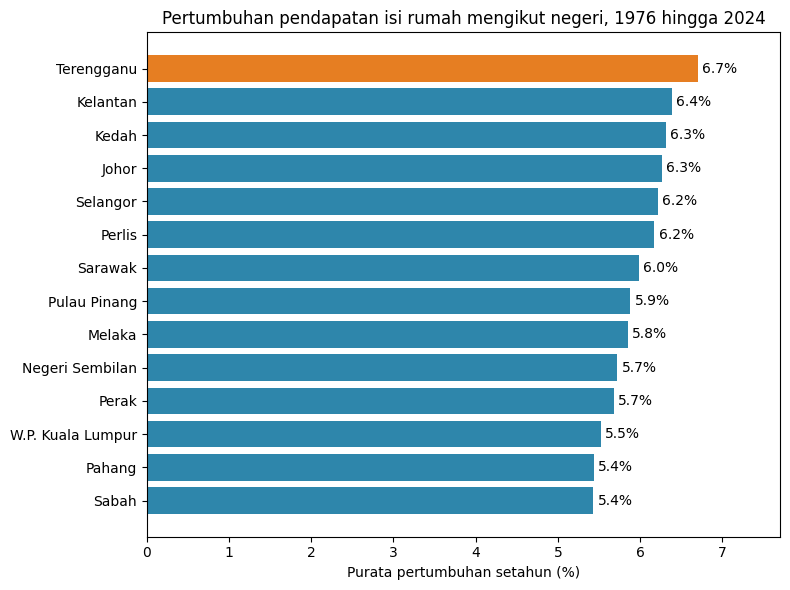
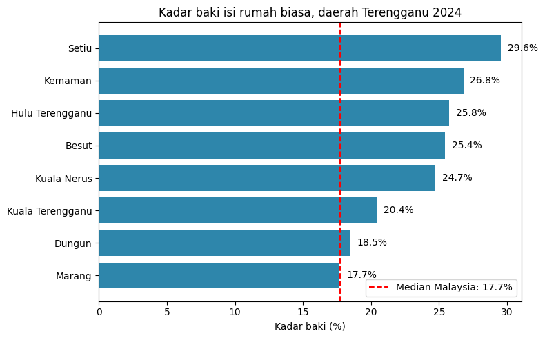
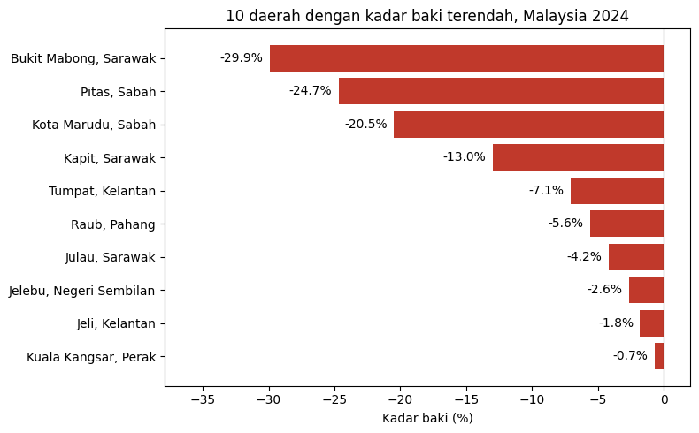

# Household Income and Spending in Malaysia, by District and State

Python project using official household income data from the Department of Statistics Malaysia (DOSM).

## Business Questions

1. In which districts does a household have the most and the least money left after spending?
2. How do districts in Terengganu compare with the rest of Malaysia?
3. Is the average income a fair measure of how well households live?
4. Which states grew household income the fastest from 1976 to 2024?

## Dataset

- Source: [Household Income and Expenditure Survey, DOSM (data.gov.my)](https://open.dosm.gov.my/data-catalogue)
- District table: 322 rows (2022 and 2024). Mean income, median income, mean spending, Gini and poverty rate.
- State table: 319 rows, survey years from 1970 to 2024. Mean and median income.
- Tools: Python, pandas and matplotlib in Google Colab.

## Data Cleaning and Checks

- No blank cells and no duplicate rows in the district table.
- Median income is missing for 11 states in 1970. The growth analysis uses mean income.
- Sepang shows a 0.0% poverty rate in 2022. Kept as a valid value.
- 6 district names had different spellings in 2022 and 2024, for example "S.P. Selatan" and "Seberang Perai Selatan". Also "Hulu" in 2024 became "Hulu Terengganu". Names now follow the 2022 spelling.
- After this fix, 6 new districts appear in 2024 only (5 in Sarawak, 1 in Sabah). Perlis, Kuala Lumpur, Labuan and Putrajaya have no district rows in 2024.
- The district analysis uses the 162 districts in 2024.

## Method

Money left = income minus spending. Savings rate = money left as a share of income.

I calculated the savings rate in 2 ways:

1. Mean income minus mean spending.
2. Median income minus mean spending. The median shows the typical household. DOSM does not publish median spending, so this second figure is an estimate.

Growth per state uses the average yearly growth rate (CAGR) of mean income from 1976 to 2024. 1976 is the first year with data for Sabah, Sarawak and Kuala Lumpur, so all 14 states start from the same year. Labuan and Putrajaya have no 1976 data and are left out.

## Key Findings

1. The mean figure misleads in east Sabah. Kunak has the highest savings rate by mean income (57.7%), yet 29.2% of its households live in poverty. In Kalabakan, mean income is RM5,174 but median income is only RM3,304. A small group of high earners pulls the mean up.
2. With median income, 10 of 162 districts have a negative balance. The typical household there spends more than it earns. The lowest are Bukit Mabong, Sarawak (-29.9%, short by RM774 a month), Pitas, Sabah (-24.7%) and Kota Marudu, Sabah (-20.5%).
3. The 4 lowest districts sit in Sabah and Sarawak. The 6 in Peninsular Malaysia sit closer to zero (-0.7% to -7.1%). These include Tumpat and Jeli in Kelantan.
4. All 8 districts in Terengganu have a positive balance. 7 sit above the Malaysian median of 17.7%. Setiu ranks highest (29.6%). Marang sits at the median (17.7%) and ranks lowest in Terengganu in both methods. Kuala Terengganu, the state capital, ranks second lowest (20.4%).
5. Income and inequality show no link (correlation 0.03). Income and poverty move in opposite directions (-0.52). Poverty and the mean savings rate show no link (0.01).
6. Terengganu grew household income the fastest of all 14 states: 22.5 times, from RM339 in 1976 to RM7,627 in 2024, or 6.7% a year. Terengganu also ranks first from 1970 (7.3% a year).
7. Sabah and Pahang grew the slowest (5.4% a year). Sabah also holds 3 of the 10 districts with a negative balance.

## Recommendations

1. Use median income, not mean income, to judge district welfare. The mean hides poverty in districts with high inequality.
2. Focus cost of living aid on the 10 districts with a negative balance, starting with Bukit Mabong, Pitas and Kota Marudu.
3. In Terengganu, study Marang and Kuala Terengganu first. Both trail the other districts in the state.

## Limits of This Analysis

- Median income minus mean spending mixes 2 measures. Treat the second savings rate as an estimate.
- All income figures are nominal. They do not adjust for inflation.
- District data covers 2 survey years only (2022 and 2024).
- Spending needs and prices differ between districts. A lower balance points to where households need support. It does not rank the people who live there.
- Correlation does not prove cause. Terengganu income nearly doubled from 1970 to 1976, the same period the oil and gas industry began in Kerteh. This data does not test this link.

## Files

- `household_income_analysis.ipynb`: Colab notebook with all code, outputs and notes
- `carta_pertumbuhan_negeri.png`: income growth by state, 1976 to 2024
- `carta_terengganu.png`: savings rate of Terengganu districts
- `carta_10_terendah.png`: 10 districts with the lowest savings rate

